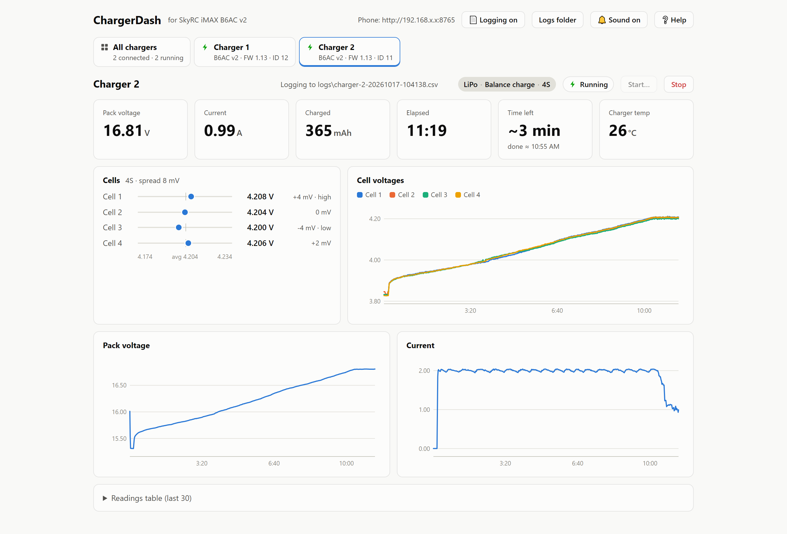
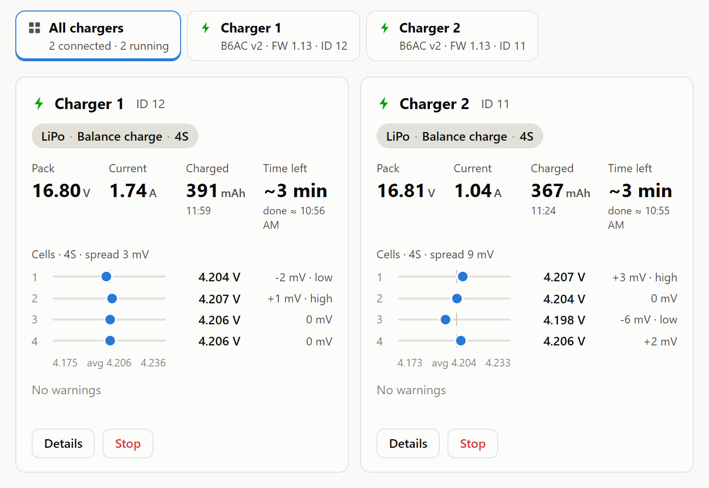
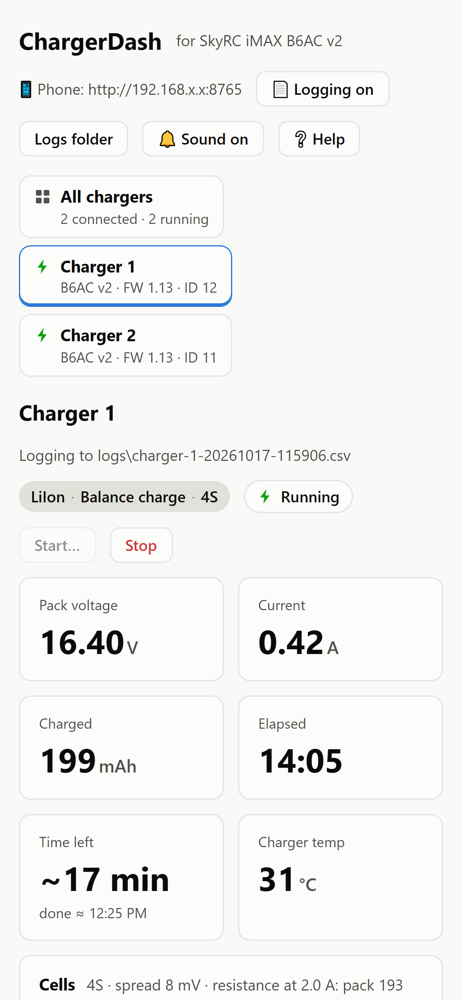

# ChargerDash for SkyRC iMAX B6AC v2

A live dashboard for one or more **SkyRC iMAX B6AC v2** chargers, connected to a Windows PC over
USB. Watch every cell, see each cell's internal resistance, start and stop programs, and follow
along from your phone.

<picture>
  <source media="(prefers-color-scheme: dark)" srcset="screenshots/charging-dark.png">
  
</picture>

<details>
<summary>More screenshots</summary>

**All chargers:** one row per charger, with each cell's voltage and internal resistance.



**Phone:** click the 📱 address in the header and scan the QR code with a phone on the same WiFi.



</details>

## Download and run

1. Download **ChargerDash.exe** from the [Releases](../../releases) page and double-click it.
   Nothing to install.
2. The first time, Windows may show **"Windows protected your PC"** (SmartScreen). Click
   **More info → Run anyway**. That's normal for small apps that aren't code-signed.
3. If SkyRC's own ChargeMaster software is open, close it: only one program can talk to the
   charger at a time.
4. Plug the charger into the PC with its USB cable. ChargerDash finds it within a few seconds.
5. Using more than one charger? Give each an ID by setting its **Waste time** to a different
   value (anything but the default 10 min, e.g. 11, 12). The in-app **Help** explains how.

To watch from your phone, click the 📱 address in the header and scan the QR code. The first
time, Windows Firewall may ask about network access; allow it on private networks.

**Use at your own risk.** ChargerDash is an unofficial hobby tool, not made or supported by SkyRC.
Only the iMAX B6AC v2 has been tested, with the packs and programs listed under [Tested](#tested).
LiPo packs can catch fire: never leave a charge unattended, and charge on a fireproof surface or
in a LiPo bag.

## Features

- **Live readings and charts:** pack voltage, current, mAh, elapsed time, charger temperature and
  every balance cell's voltage, charted as the program runs.
- **Several chargers at once:** each gets its own tab, and **All chargers** shows them all side
  by side.
- **Internal resistance** per cell and for the pack, measured from the voltage step when charge
  current starts (the charger's 0 A check, then the first reading once current has settled). It
  needs the app open when the program starts, and can't be measured on a pack that's already at
  its target voltage. Best for comparing cells and tracking a pack over time; it includes the
  balance plug's contact.
- **Health warnings:** cell imbalance (30 / 100 / 200 mV), a cell drifting away from the rest
  during a program, low (< 3.30 V) or over-discharged (< 3.00 V) cells, cells above full charge,
  main and balance leads disagreeing while a program runs, a cell with much higher internal
  resistance than the rest, and a hot charger. Thresholds are in `HEALTH` in `static/index.html`.
- **Start and Stop:** balance charge or storage for LiPo, LiIon or LiHV, with 0.5 / 1.0 / 1.5 /
  2.0 A quick picks or your own current (up to 6 A). The cell count is detected from the balance
  lead, and the **Cells** picker (1S–6S) must agree with it. Start is refused if the balance lead
  is missing or has a gap, or if any cell is below 3.00 V or above the chosen type's full charge.
  The charger doesn't report the main lead while idle; it checks the cell count against the main
  lead itself as the program starts, and the dashboard warns if the leads disagree while it runs.
- **Lost-contact alarm:** if readings stop for more than 5 s while a program is running, or the
  charger drops off USB mid-program, the charger's tab turns red ("No readings") and a loud alarm
  sounds without a break, even with **Sound** off, until you press **Silence alarm**. It keeps
  going after readings come back, so a lost-contact episode can't pass unnoticed. The charger may
  still be charging with nothing watching it, so check its screen.
  Replugging the USB lead mid-program has left a charger connected but silent; after 10 s with no
  answer the dashboard drops the connection and reopens it, and the program carries on in the same
  log file.
- **Time left:** an estimate that learns from the programs it watches finish.
- **Phone view:** the same dashboard on any phone on your WiFi, via the QR code.
- **Logging and sound:** each program is saved to a CSV file (switch it off with **Logging**), and
  a sound plays when a program finishes or stops with an error.

Each charger's last battery, program and current choices are remembered, so every browser and
phone opens with them. Names (`chargers.json`), settings (`settings.json`) and charge logs
(`logs\`) live in **Documents\ChargerDash**; set `CHARGERDASH_DATA` to use a different folder.

## Tested

On two SkyRC iMAX B6AC v2 chargers (machine id 100008, firmware 1.13), each program started with
ChargerDash's **Start** button and watched live:

| Battery | Cells | Program | Result |
|---|---|---|---|
| LiPo | 6S | Balance charge | Charged to full and finished |
| LiPo | 6S | Storage | Finished at storage voltage |
| LiPo | 4S | Balance charge | Charged to full and finished, both chargers |
| LiPo | 3S | Balance charge | Charged normally; not watched to the finish |
| LiHV | 2S | Balance charge | Charged normally towards 4.35 V per cell; not watched to the finish |
| LiIon | 4S | Balance charge | Charged normally towards 4.10 V per cell; not watched to the finish |

The charger reads each program back with the type, cell count and mode it was sent. While running,
its main-lead voltage matched the balance-lead total to within 0.03 V.

Not tested yet: **1S** and **5S** packs, LiIon on chargers with machine id 100130 (which use type 2
for LiIon), and any charger other than the B6AC v2. Use these with extra care, and please report
how they go.

### Overcharge seen after replugging USB mid-charge

On 2026-10-19 a 4S LiPo charge on one charger ended with the pack overcharged. The USB lead had been unplugged and plugged back in while the
charge was running. The pack was discharged straight away.

What the readings show: the program started at 3.85 V per cell, and after one reading the charger
stopped answering over USB for about 25 minutes while it stayed connected. The dashboard (before
the lost-contact alarm existed) kept showing that first reading as if it were live, so nothing
recorded the overcharge itself. When the charger next answered it reported the program as finished
after 1 second with 0 mAh, which doesn't match a 25-minute charge, and it reported the program as
an unrecognised mode ("Program 1") rather than Storage or Balance charge.

The cause isn't proven, and it is not necessarily the dashboard. ChargerDash only sends the
charger the same standard commands SkyRC ChargeMaster uses: read-only status queries every second,
and Start or Stop only when you press those buttons. A LiPo Start asks for a 4.20 V per-cell
maximum. The charger runs the program and enforces the voltage limits in its own firmware; the
dashboard can't push a pack past them, and it sends nothing but status queries unless Start or Stop is pressed. The likeliest
explanation is that replugging USB mid-program left the charger's firmware in a bad state, though
that can't be confirmed from the data.

So: **don't unplug or replug the USB lead while a program is running**, and keep an eye on the
charger's own screen. The lost-contact alarm (see [Features](#features)) now sounds if this
happens again.

## Run from source or build

```bash
pip install -r requirements.txt
python app.py
```

`app.py` opens the dashboard in its own window (Edge WebView2, built into Windows); closing the
window quits. `python server.py` runs just the server with no window, for a browser at
http://localhost:8765.

**Build the exe:** run `build.bat`, which writes `dist\ChargerDash.exe` with PyInstaller.

## Protocol notes (reverse-engineered, firmware 1.13)

USB HID, VID `0x0000` PID `0x0001`. Send the 64-byte report `0F 03 55 00 55 FF FF 00…`.
The reply is `0F 22 55 00 …`, with big-endian u16 values:

| Offset | Meaning |
|---|---|
| 4 | mode: 1 = running, 2 = idle, 3 = finished, 4 = stopped with an error |
| 5–6 | mAh (the error code in mode 4) |
| 7–8 | elapsed seconds |
| 9–10 | pack mV, read on the main lead |
| 11–12 | current mA |
| 13–14 | internal temp °C (likely) |
| 17–28 | cells 1–6, mV |
| 35 | checksum = sum(bytes 2..34) & 0xFF |

These values are live only while running (mode 1). Error codes include 13 = balance connection
error and 15 = cell number incorrect.

When not running, the status reply carries leftovers: in mode 2 bytes from earlier replies, and
in mode 3 the last program's pack voltage. Live cell voltages then come from the `0x5A` system
reply (`0F 25 5A 00 …`), cells from byte 20. Its bytes 18–19 read 15–16 V whatever pack is
connected (4S or 6S alike), so they're most likely the charger's DC input. The main lead isn't
reported at all while idle.

Other read-only queries use the same shape, `0F 03 <cmd> 00 <cmd> FF FF`:

- `0x5F` program: payload `state | batt type | cells | ? | max charge A×10 | max discharge A×10 | ? | mode | …`.
  Types are LiPo, LiIon, LiFe, LiHV, NiMH, NiCd, Pb (machine id 100130 swaps LiIon and LiFe).
  Li modes are Charge, Discharge, Storage, Fast, Balance.
- `0x57` machine id: ASCII at bytes 5–10, `100008` on this charger.

Commands, worked out from how SkyRC ChargeMaster drives the charger (no ChargeMaster code is
included here), each acknowledged with `F0 FF FF`:

- Stop: `0F 03 FE 00 FE FF FF`. Also clears a finished or error result before the next Start.
- Start: `0F 16 05 00 | type cells mode | charge mA (u16) | discharge mA (u16) | min mV | max mV | 8 × 00 | checksum FF FF`,
  where type 0 = LiPo, 1 = LiIon (2 on machine id 100130), 3 = LiHV, and mode is 0 charge,
  1 discharge, 2 storage, 3 fast, 4 balance. Min/max mV per cell: LiPo 3200/4200,
  LiIon 3100/4100, LiHV 3000/4350.
  The checksum is the sum of every byte from `05` through the last `00`, & 0xFF.
  For example, 6S storage at 1 A is `0F 16 05 00 00 06 02 03 E8 03 E8 0C 80 10 68 00 00 00 00 00 00 00 00 E7 FF FF`.
  Confirmed live: types 0, 1 and 3, modes 2 and 4, with 2, 3, 4 and 6 cells.

The chargers have no USB serial number. The dashboard uses each charger's **Waste time** setting
as its ID (10 min, the factory default, means no ID); chargers without an ID are told apart by
USB port.

## Licence

MIT, see [LICENSE](LICENSE). Not affiliated with SkyRC.

The exe bundles Python and these open-source libraries, each under its own licence:
[hidapi](https://github.com/trezor/cython-hidapi) (BSD/GPL-3.0, used under BSD),
[pywebview](https://github.com/r0x0r/pywebview) (BSD-3-Clause) with
[pythonnet](https://github.com/pythonnet/pythonnet), [clr-loader](https://github.com/pythonnet/clr-loader),
[bottle](https://github.com/bottlepy/bottle) and [proxy_tools](https://github.com/jtushman/proxy_tools) (all MIT),
and [segno](https://github.com/heuer/segno) (BSD-3-Clause, for the phone QR code).
